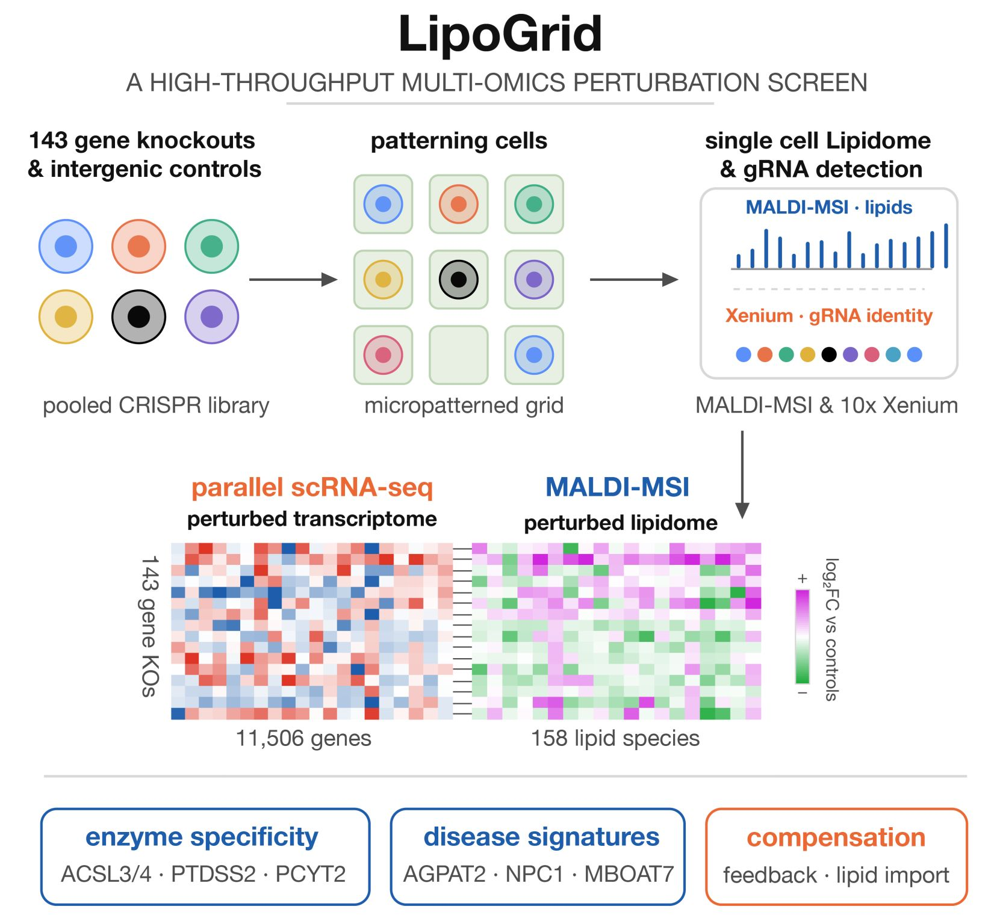

# Laboratory of Multi-omic Integrative Bioinformatics (LMIB) — Website

Website of the **Laboratory of Multi-omic Integrative Bioinformatics (LMIB)**, KU Leuven, Department of Human Genetics and Leuven Single-Cell Institute (LISCO), led by Prof. Alejandro Sifrim.

- **Live website**: https://www.sifrimlab.org
- **GitHub organisation**: https://github.com/sifrimlab
- **Stack**: Vue 3 + TypeScript + Vite. Markdown content is compiled to typed data and every page is prerendered to static HTML.

---

## Editing content

All content lives in Markdown files with YAML frontmatter under [`content/`](content/), plus the publication list in [`_data/sources.yaml`](_data/sources.yaml).
Pushing to `main` triggers `.github/workflows/build-site.yaml`, which builds and deploys the site.

> **Accuracy rule.** The build fails if content refers to something that does not exist: an unknown DOI, team member, resource or image.
> Every publication shown on the site comes from `_data/citations.yaml`, which is generated from DOIs. Please do not write paper titles or author lists by hand.

```text
content/
├── home/index.md            # Landing page: title, tagline, affiliation, welcome text, featured publications
├── research/NN-<slug>.md    # One file per research theme (all shown on /research)
├── projects/<slug>.md       # Methods & resources (software, benchmarks, data browsers), linked from a theme
├── team/<slug>.md           # Current members (team/alumni/ for former members)
├── news/YYYY-MM-DD-<slug>.md
└── join/NN-<slug>.md        # How to apply, per career stage
```

### Research themes — `content/research/*.md`

Each theme gives the **biological question** and the **computational approach** equal weight.

```yaml
---
slug: rna-subcellular            # used as the anchor: /research#rna-subcellular
title: Subcellular RNA organisation and spatial transcriptomics
order: 3
question: >-                     # the biological question (shown in the orange "biology" ink)
  Where does an mRNA molecule sit inside a cell, ...
approach: >-                     # the computational approach (shown in the blue "computation" ink)
  Self-supervised representation learning on ...
resources: [subcellspace]        # slugs of content/projects/*.md
publications:                    # ids exactly as in _data/sources.yaml
  - doi:10.64898/2026.04.28.720613
people: [david-wouters, ceyhun-alar]   # file names in content/team/
---
Body text in Markdown. Use *italics* for gene symbols, e.g. *LRP2*.
```

### Methods & resources — `content/projects/*.md`

```yaml
---
slug: subcellspace
title: SubCellSpace
theme: rna-subcellular           # slug of the research theme it belongs to
kind: Method                     # Method | Software | Benchmark | Screening platform & data browser | ...
order: 1
summary: >-
  One or two sentences, taken from the paper's abstract.
image: /images/research/subcellspace.png   # a web-sized figure (keep it below ~600 KB)
imageFit: contain                # contain (diagrams, logos) or cover (photos, screenshots)
imageCaption: What the figure shows.
links:                           # all optional; only those present are shown
  paper: https://doi.org/...
  code: https://github.com/sifrimlab/...
  docs: https://sifrimlab.org/...
  browser: https://sifrimlab.org/...
---
```

### Team — `content/team/*.md` and `content/team/alumni/*.md`

```yaml
---
name: Jane Doe
role: phd                        # pi | postdoc | staff | phd | programmer | grad
roleLabel: PhD Student
image: /images/team/jane-doe.jpg
links:
  orcid: 0000-0000-0000-0000
  googleScholar: XXXXXXXXXXXX
  github: janedoe
  linkedin: jane-doe
  twitter: janedoe
  website: https://example.org
---
Short biography in Markdown.
```

- Put photos in `public/images/team/`. If a web-sized copy with the same name exists in `public/images/team/web/<name>.jpg` (max. 800 px), that copy is used. On macOS: `sips -s format jpeg -Z 800 in.jpg --out public/images/team/web/jane-doe.jpg`.
- To move someone to the alumni, move their file to `content/team/alumni/`.
- Authors in publication lists are matched to team members by first and last name, so the site can link and highlight them.

### News — `content/news/YYYY-MM-DD-<slug>.md`

```yaml
---
slug: lipogrid
title: Introducing LipoGrid
date: '2026-09-18'
tags: [paper]                    # paper | research | awards | event | conference | job
image: /images/news/lipogrid.jpg # used as the thumbnail
---
Post body in Markdown. Images: 
```

Posts tagged `job` also appear under "Open positions" on the Join page.

### Publications — automatic, weekly

`_data/citations.yaml` is **generated** — don't edit it. The `update-citations` workflow
([`.github/workflows/update-citations.yaml`](.github/workflows/update-citations.yaml)) runs every Monday
(and on demand from the Actions tab), runs [`_cite/cite.py`](_cite/cite.py), commits the result to `main`
and redeploys the site. No secrets are needed.

Where the citations come from:

| Source | File | Notes |
|---|---|---|
| ORCID of the group leader | `_data/orcid.yaml` | Works with a DOI/arXiv id; works without one are matched by title via Crossref |
| Google Scholar of the group leader | `_data/google-scholar.yaml` | Free `scholarly` scraper; titles are resolved to DOIs via Crossref. Scholar often blocks automated clients — then it is skipped with a warning and ORCID still works |
| Pinned works | `_data/sources.yaml` | `- id: doi:10.…` or `- id: arxiv:…`. Always kept; use it for anything referenced from `content/` (research themes, home page) and to override fields (e.g. a `title:`) |
| Exclusions | `_data/citations-exclude.yaml` | Ids to drop, e.g. a wrong match or a duplicate preprint |

Only **lab publications** are kept: the group leader plus at least one other person listed in `content/team/` (alumni included) must be on the paper. Pinned ids bypass this rule, with a warning.
Add `links: orcid:` to a member's front matter to make this robust: a member is recognised by ORCID iD
(Crossref author ORCIDs, or the DOI being on the member's own ORCID record), and when both an author and a member
have an ORCID iD, names are ignored, so look-alike names are told apart. Members without an ORCID iD are matched by
first given name + family name. Members' ORCID records are also read to discover works.

Each id is formatted by Manubot/Crossref, then cleaned (HTML/entities removed, ALL-CAPS titles sentence-cased,
canonical DOI links), corrections are dropped, and preprints are dropped when a published version is present
(unless pinned). The commit only happens if the result is valid and the site content still compiles.

Run locally: `pip install -r _cite/requirements.txt && python _cite/cite.py && npm run content:compile`.

---

## Design

- **Colour.** "Paper and two inks": a warm paper ground with blue-black text. The logo's orange stands for **biology** and a deep blue for **computation**, used with equal weight. Dark mode is a blue-grey night, not black. Tokens are in [`src/styles/tokens.css`](src/styles/tokens.css).
- **Type.** *Newsreader*, an editorial serif, for headings and reading text; *Instrument Sans* for navigation, labels and metadata. Both fonts are self-hosted, so the site makes no third-party requests.
- **Motifs.** The "pair" glyph (an orange node linked to a blue node) and the hero network are both taken from the logo's node-graph.

## Development

```bash
npm install
npm run dev        # compile content + dev server
npm run build      # compile content, type-check, build, prerender every route into dist/
npm run preview    # serve dist/
```

- `BASE_PATH=/some/sub-path/ npm run build` builds for a sub-path (the live site uses `/`).
- Pull requests are build-checked only (`on-pull-request.yml`); the built site is attached to the run as a `site-preview` artifact. Deployment happens on push to `main` via GitHub Pages (Settings → Pages → Source: **GitHub Actions**).
- `HYDRATION_DEBUG=1 npm run build` logs prerender/hydration mismatches in the browser console.
