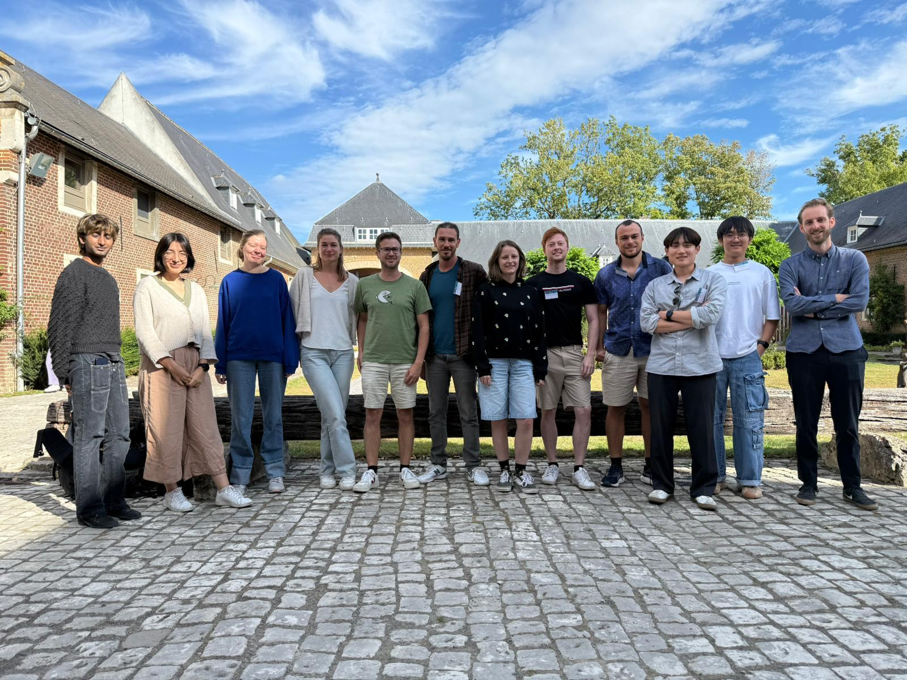

Together with Lars Borm ([Stein Aerts lab](https://aertslab.org/)), Jelle, Lorenzo and Alejandro organized and supervised the Spatial Omics Data Analysis track of the [VIB/SIB Machine learning and AI Summer School](https://www.vibconferences.be/events/machine-learning-and-ai-summer-school#program). In real hackathon style, we tackled pertinent challenges in the field, including automated segmentation of biologically relevant microstructures to then generate representative embedding using the spatial omics data.

