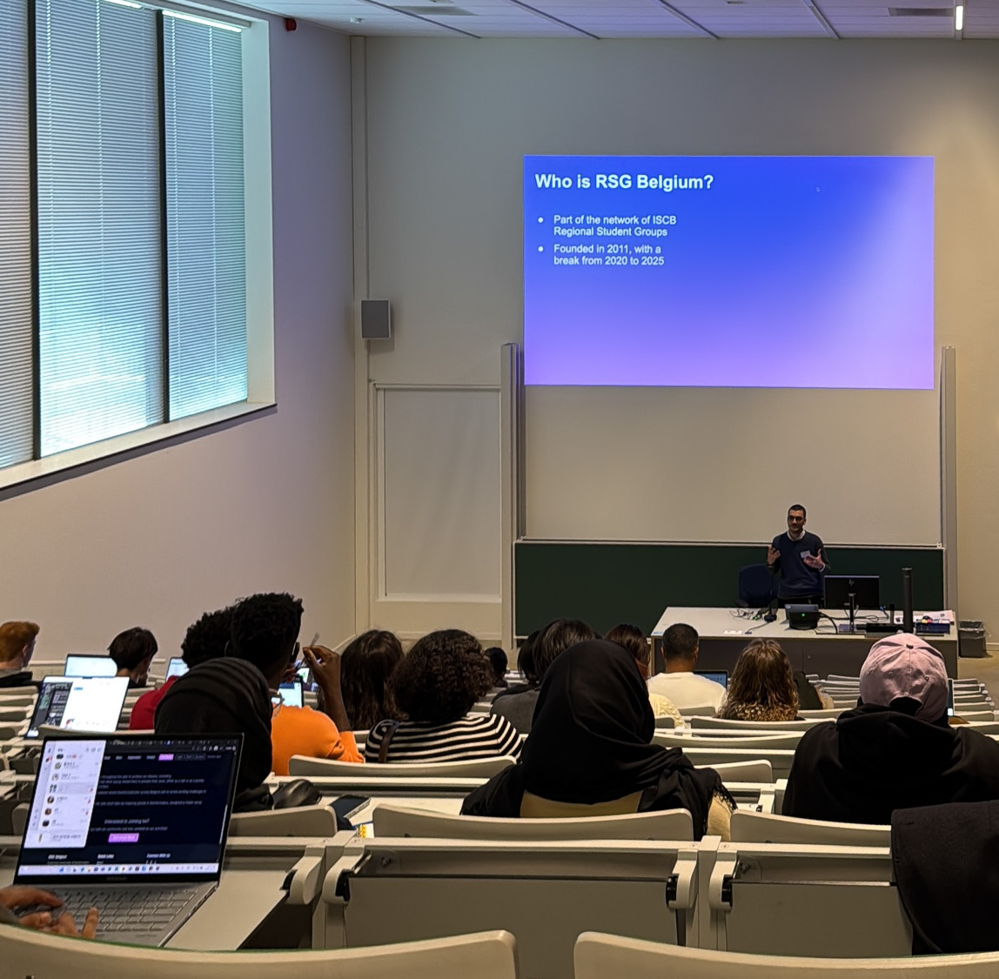
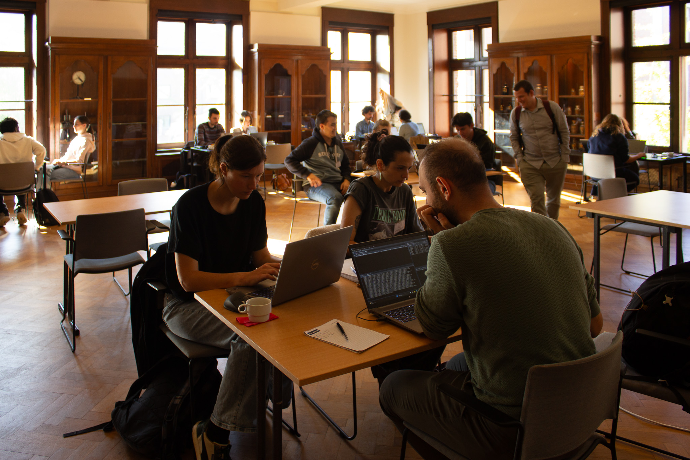
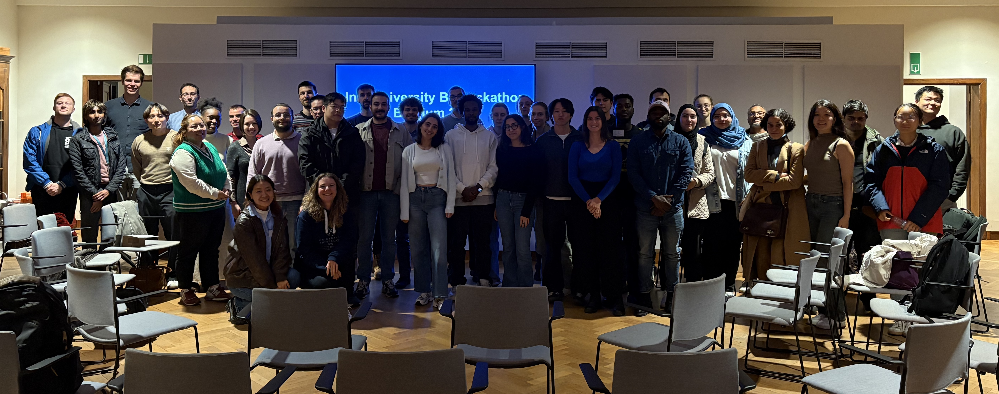

On September 24 and 25, our colleagues Anis and Saptarshi led the organization of the first Interuniversity Biohackathon Belgium, marking the return of the Regional Student Group (RSG) Belgium of the International Society for Computational Biology (ISCB) after a five-year hiatus.

In collaboration with colleagues from VUB/ULB, University of Antwerp, and with speakers from Instadeep and Scienta Lab, the hackathon kicked off with inspiring keynotes and hands-on sessions delivered by field experts. Anis, President of RSG Belgium, then unveiled the three hackathon challenges, with teams working intensively across the tracks before presenting their final pitches to the jury the next day.

We warmly congratulate all winning teams and thank the organizing committee: Anis, Saptarshi, Wim, Nassim, Eline and volunteers Fatemeh and Vasiliki, for delivering such an exciting and successful event: a true milestone for RSG Belgium’s comeback.

You can learn more about RSG Belgium [here](https://rsg-belgium.org/).

  

    

  

  

    

  

  

    
  

