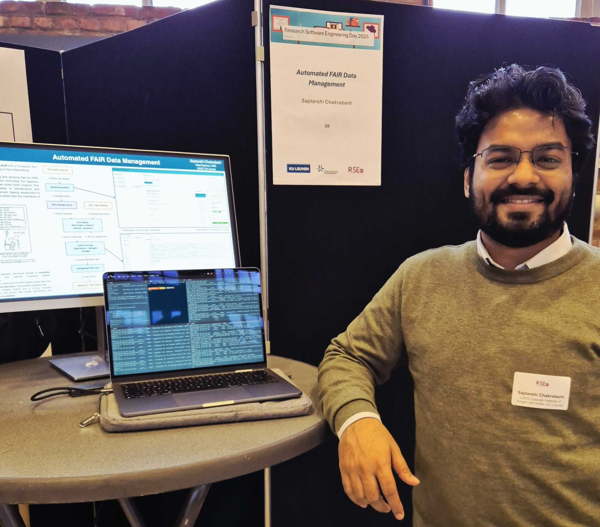
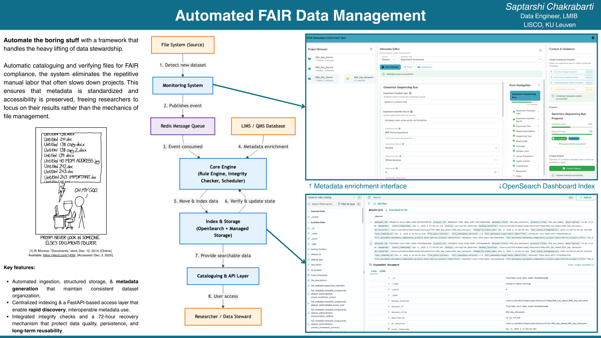

Research Software Engineering (RSE) is a relatively new field that spans several disciplines while sitting at the intersection of software engineering and research. The needs of software engineering in academic research differ significantly from those of its traditional commercial counterpart.  
We presented our attempt at adding to the rich contributions of the Belgian Research Software Engineering Community (BE-RSE) at the RSE Day organised by KU Leuven on 4 December 2025, with a demonstration of the Automated FAIR Data Management tool developed by our Data Engineer Saptarshi at LMIB/LISCO. This tool aims to automate the management of data throughout its lifecycle, from ingestion to archival, while remaining compliant with FAIR principles.

  

    

  

  

    

  

