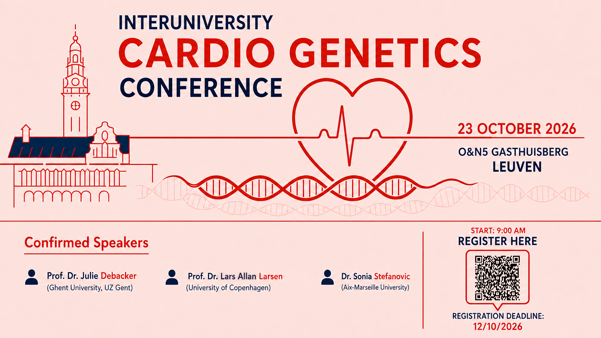

On Friday, 23 October 2026, the Interuniversity Cardio Genetics Conference will bring together researchers, clinicians, and experts in cardiovascular genetics for a one-day scientific meeting in Leuven, Belgium, hosted at O&N5 Gasthuisberg.
The programme is organised around three complementary perspectives: clinical genetics and cardiology, genetic research, and model systems and development. Confirmed speakers include Prof. Dr. Julie De Backer (Ghent University Hospital & Ghent University), Prof. Dr. Lars Allan Larsen (University of Copenhagen), and Dr. Sonia Stefanovic (Aix-Marseille University), alongside short talks and a poster session from early-career researchers.
The day offers a chance to exchange knowledge, discuss current developments in cardiogenetics, and connect researchers and clinicians across universities and institutions, closing with a networking session.
**Registration is open via an online form, with a deadline of 12 October 2026.**
More information can be found [here](https://cardiogeneticsleuven2026.github.io/)

