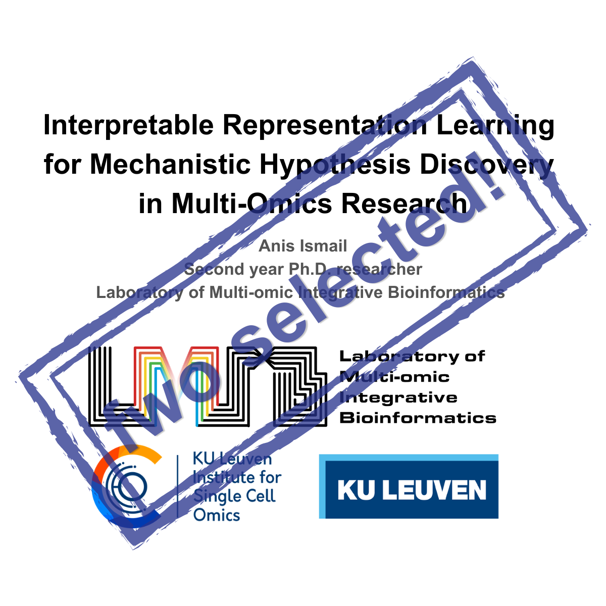

We are thrilled to share that our colleague Anis has been awarded a PhD fellowship from the Research Foundation Flanders (FWO)!

This fellowship will support his doctoral research in our lab, where he will focus on using explainable AI to interpret representation learning models to uncover novel biological hypotheses in multi-omics research.

A huge congratulations to Anis for this outstanding achievement, we’re proud and excited to see his research take off!

